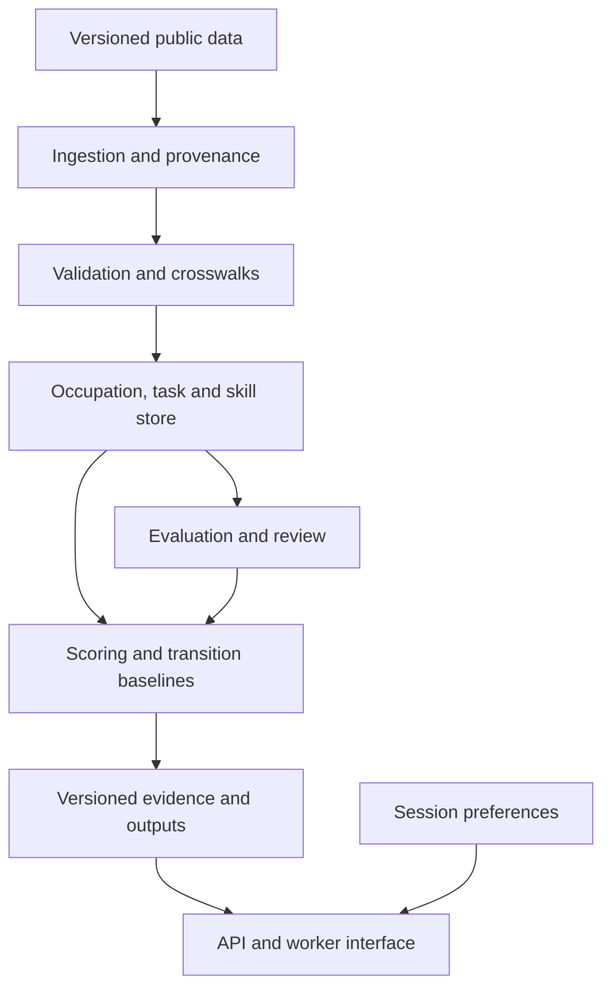

# System and technical architecture
## Design
A batch pipeline prepares auditable occupation intelligence. Online requests read precomputed outputs and apply worker-selected feasibility constraints. Separate source facts, research annotations and derived scores.

## Components and contracts
| Component | Inputs | Outputs | Failure behavior |
|---|---|---|---|
| Acquisition | Pinned catalog entry and downloaded bytes | Immutable raw file, SHA-256 manifest | Stop on missing release/license metadata |
| Normalization | Raw table and release dictionary | Typed relational records | Quarantine unknown columns and scales |
| Crosswalks | Versioned source occupation codes | Mapped relationships and coverage report | Preserve ambiguity; never silently trim codes |
| Exposure/HVI | Task evidence, selected dimensions and rubric | Experimental components, uncertainty, reasons | Return insufficient evidence when unsupported |
| Transition baseline | Skill vectors, wages, outlook, preferences | Up to five candidates and gap details | Exclude self and infeasible candidates |
| API | Versioned dataset and method IDs | Fact/estimate distinction and provenance | Explicit no-match/missing states |
| Interface | API responses | Worker exploration flow | Never imply unavailable evidence is zero |
| Evaluation | Frozen outputs and independent annotations | Metrics, failure analysis and decision record | No promotion without documented review |

## Technology decisions
Python 3.11+ for pipelines and baseline scoring. Start with the standard library for foundation checks. Add pandas/Parquet and scikit-learn only as ingestion and similarity implementations arrive, pinning dependencies then.

SQLite is the executable local MVP store; the initial [DDL](../schema/001_initial.sql) is tested in memory. Migrate to PostgreSQL when concurrent serving or deployment requires it; this DDL is not a PostgreSQL migration. Relational occupation–skill edges support graph-style baselines. Neo4j is deferred until graph exploration adds measurable value, with export from canonical relational records rather than a second source of truth.

Plan FastAPI for the service and a small Streamlit interface for the first research demo. A separate Next.js product UI, Docker deployment, MLflow and cloud services are later decisions. No runtime dependency, hosting bill or API credential is needed for Phase 0.

## Storage and provenance
- Raw: immutable release files outside Git under data/raw/<dataset>/<release>/.
- Interim: typed source-specific records, quarantine and mapping reports.
- Processed: joined tables and baseline vectors, partitioned by source snapshot and method.
- Research: annotation set IDs, train/test definitions, prompts and experiment metadata.
- Model outputs: score components, confidence basis, coverage and evidence references.
- Personal information: transient MVP sessions; no persisted resumes or interviews.

## Proposed API contract (not implemented)
- GET /occupations?q=... : title/code candidates with release metadata.
- GET /occupations/{code}/tasks : statements, ratings and provenance.
- GET /occupations/{code}/analysis : scores, coverage, components and method.
- POST /transitions : current occupation, explicitly declared skills and preferences.
- GET /occupations/{code}/skill-gap?target=... : occupation-profile gap, clearly labeled as a proxy.

Every response includes dataset_snapshot, method_version, generated_at, warnings, and evidence IDs. Missing values use null with a reason. Limit returned records and validate user input. No endpoint executes arbitrary user-provided code or SQL.

## Deployment and observability
Run local first. Before deployment: container build, dependency lock, request limits, secret management, structured logs without personal content, health checks and rollback procedure. Monitor input schema drift, coverage changes and recommendation constraint failures. Re-evaluate methods after source or capability updates; do not silently replace snapshots.

## Repository structure
The repository now contains acquisition, workbook parsing, O*NET/BLS importers, an atomic pipeline, source-detail migration and command-line exploration. Features, scoring, transitions, evaluation and API modules are later work. See running-pipeline.md for executable examples and tests. No service is claimed to run.
